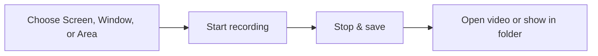
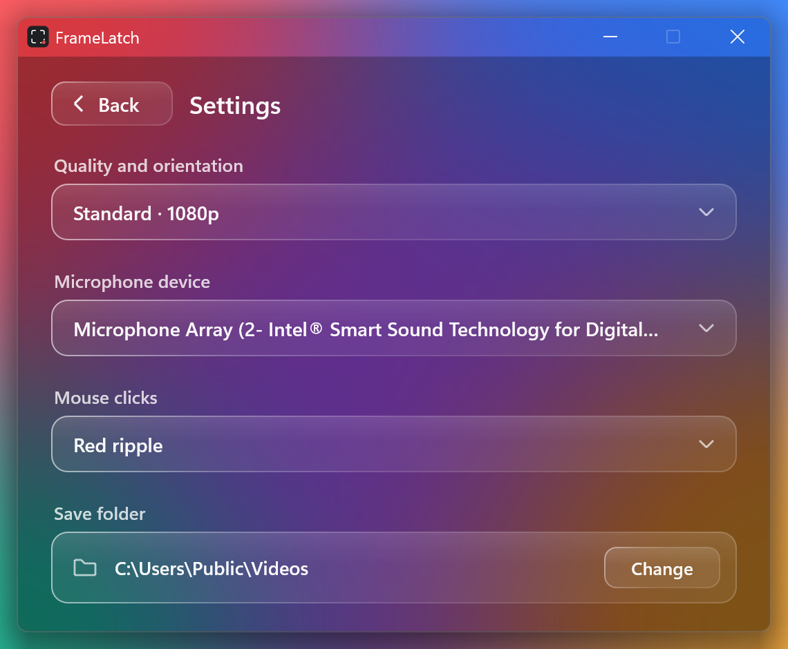
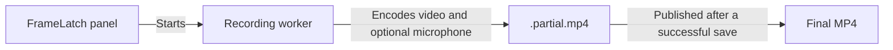

# FrameLatch

FrameLatch is a lightweight Windows screen recorder. Capture a monitor, an app window, or a rectangle on your screen and save it as an MP4. You can add microphone narration and highlight mouse clicks.

[Install on Windows](#install-on-windows) · [Make a recording](#make-a-recording) · [Find an interrupted recording](#find-an-interrupted-recording) · [Build from source](#build-from-source)

<p align="center">
  
</p>

## Install on Windows

FrameLatch is built for 64-bit Windows 10 version 2004 or later and Windows 11. On Windows N editions, install Microsoft's Media Feature Pack.

1. Open [GitHub Releases](https://github.com/antonijo01/FrameLatch/releases) and look under **Assets** for `FrameLatch-Setup-<version>.exe`.
2. Run the installer. The default installs for your account without administrator access. The wizard also offers an all-users install and an optional desktop shortcut.
3. Open **FrameLatch** from the Start menu.

The installer has yet to be published on GitHub. Until it appears under **Assets**, use a copy of the installer you already have or [build it from source](#build-from-source). Access to releases in a private repository requires access to the repository.

Windows SmartScreen may show a warning for the unsigned installer. Run the file only if you trust its source. To uninstall, find **FrameLatch** under **Settings → Apps**. Your recordings and settings are kept.

## Make a recording

1. Choose **Screen** for a whole monitor, **Window** for one app window, or **Area** to draw a rectangle on a monitor.
2. Turn on **Microphone** if you want narration. Use **Settings** to choose a microphone, quality preset, or click effect. Use **Change** on the save card to pick a different folder.
3. Press **Start recording**. You have three seconds to get ready. Press **Escape** or **Cancel** to cancel during the countdown.
4. Press **Stop & save** or **Ctrl+Shift+F9**. You can also close the toolbar during recording to stop and save. If the shortcut is already taken by another app, use the button.
5. After saving, choose **Open video** to play the MP4 or **Show in folder** to find it in Explorer.



By default, videos go to **FrameLatch** inside your Windows **Videos** folder. **Settings** shows the full save path.

| Settings | After a successful save |
| --- | --- |
|  |  |

## Find an interrupted recording

FrameLatch writes a `.partial.mp4` in the save folder while it records. After a successful save it becomes a regular `.mp4`. If recording stops unexpectedly, the error may show the path where the partial file was expected.

1. Open the save folder in File Explorer. Check the path in the error or in FrameLatch **Settings**.
2. Look for a recent file named `FrameLatch-…partial.mp4`. If it exists, try playing it and check how much of the recording it contains.
3. If it plays, make a copy with a descriptive `.mp4` name. Keep the original until you have checked the copy.

Some interruptions leave a playable video. A crash or failed save can leave an unreadable or empty file. Keep an unreadable partial file as-is if you plan to attempt recovery.

## Recording options

| Quality preset | Video size |
| --- | --- |
| Small file | Up to 1280 × 720 |
| Standard (default) | Up to 1920 × 1080 |
| High | Up to 2560 × 1440 |
| Ultra | Up to 3840 × 2160 |
| Original | Source size rounded down to even dimensions |
| Portrait | 720 × 1280 or 1080 × 1920 |

Landscape presets preserve the source proportions and leave smaller captures at their original size apart from rounding. Portrait presets fit the source into a tall canvas and use black bars where needed. A tall area fills more of that frame.

- **Video and sound.** Output is H.264 MP4 at 30 fps. Microphone narration is the available audio source, encoded as AAC at 44.1 or 48 kHz.
- **Pointer and clicks.** The cursor is included. Choose **Off**, **Red ring**, or **Red ripple** for click effects. In Window mode, clicks on covering windows are ignored.
- **Window mode.** You can move the selected window while recording. Closing, minimizing, or resizing it interrupts capture. Dialogs that open as separate windows are outside the capture.
- **Appearance.** FrameLatch uses its opaque interface when Windows high contrast is enabled or transparency is off.

## Build from source

On Windows, install [Visual Studio Build Tools with Desktop development with C++ and a Windows SDK](https://learn.microsoft.com/en-us/windows/dev-environment/rust/setup), and use rustup with the x64 MSVC Rust toolchain. Run these commands from your FrameLatch checkout in PowerShell.

```powershell
cargo build --locked --release
cargo test --locked --release
.\target\release\framelatch.exe
```

The app executable is `target\release\framelatch.exe`. The build uses the Windows SDK resource compiler to embed the icon. To create a setup package, install [Inno Setup 7](https://jrsoftware.org/inno-setup) and run the installer build script.

```powershell
.\scripts\build-installer.ps1
```

The installer is written to `dist\FrameLatch-Setup-<version>.exe`, using the version in [Cargo.toml](Cargo.toml). If the script cannot find Inno Setup, set `$env:ISCC` to the full path of `ISCC.exe`.

### Command-line diagnostics

```text
framelatch list
framelatch microphones
framelatch record 0 10 C:\absolute\example.mp4
framelatch record-mic 0 10 C:\absolute\example.mp4 0
framelatch probe 0 10 3
framelatch record-cycles 0 3 C:\absolute\folder 3
```

Use an existing output folder and a new filename. The [memory script](scripts/measure-memory.ps1) measures the app and recording worker together.

## How it works



FrameLatch uses a native Windows interface. The worker starts when recording begins and exits when the session ends, which lets Windows reclaim its capture and encoder resources. The video pipeline keeps only the latest captured frame pending and requests hardware encoding from Media Foundation.

On one Windows 11 development laptop, the glass interface used about 13 MiB of private memory while idle. An earlier build peaked at about 230 MiB across the app and worker during a ten-minute 1080p recording. Those figures exclude GPU memory. See [desktop validation](docs/desktop-validation.md), [high-resolution checks](docs/high-resolution.md), and the [glass interface notes](docs/glass-ui.md) for measurements and test conditions.

### Project layout

| Path | Responsibility |
| --- | --- |
| [main.rs](src/main.rs) | App entry point, CLI diagnostics, and worker command |
| [gui.rs](src/gui.rs), [glass.rs](src/glass.rs) | Main panel, settings, toolbar, and Windows drawing |
| [record.rs](src/record.rs), [audio.rs](src/audio.rs) | Worker lifecycle, capture, encoding, file saving, and microphone input |
| [area.rs](src/area.rs), [click.rs](src/click.rs), [quality.rs](src/quality.rs) | Area selection, mouse effects, and video presets |
| [installer/](installer/), [scripts/](scripts/), [assets/](assets/) | Setup definition, build and measurement scripts, and icon resources |
| [docs/](docs/) | Design notes and validation results |

### Known limits

- Microphones must use 44.1 or 48 kHz. Devices with the same name are rejected, and recording stops if the microphone timestamps jump by more than 250 ms.
- Long-session microphone sync, mixed-DPI displays, microphone unplugging, and a full disk still need dedicated validation. See [outstanding desktop checks](docs/desktop-validation.md#outstanding-qualification).

## License and support

FrameLatch is free to use under the [MIT License](LICENSE). See the [third-party notices](THIRD-PARTY-NOTICES.txt) for licenses and credits for included components.

If you’d like to support development, you can [buy Antonijo a coffee](https://buymeacoffee.com/antonijo01).
