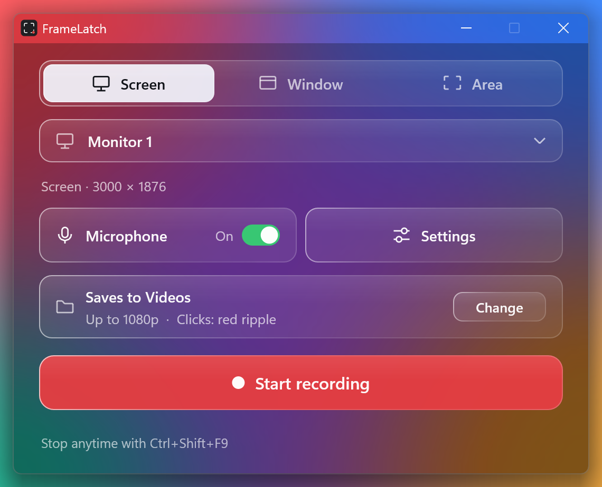
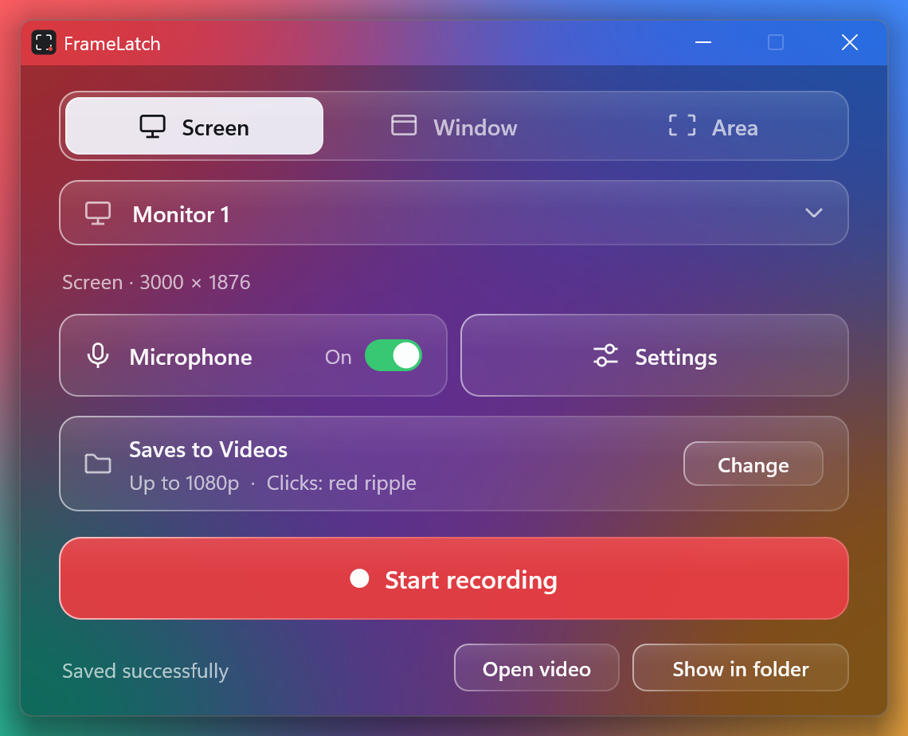
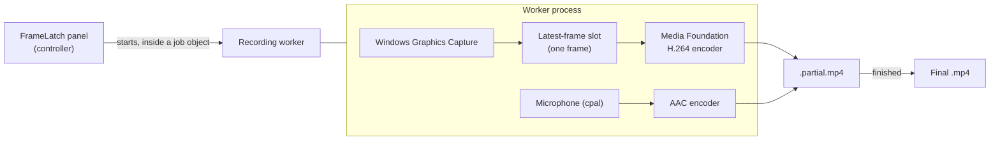

# FrameLatch

**A tiny, native screen recorder for Windows: pick what to record, press one button, get an MP4.**

FrameLatch is a single 1 MB program written in Rust against the Windows API. It has no browser engine, no runtime to install and no background service. Its translucent dark glass panel lets the desktop show through.

<p align="center">
  
</p>

## Highlights

- **One-click recording.** Choose Screen, Window or Area, then Start recording. The video is saved as an MP4, ready to share.
- **Light on your PC.** About 13 MiB of memory while idle, and nothing runs in the background until you press Start. [Why it is this small →](#why-it-is-fast-and-light)
- **Stays out of your video.** The recording toolbar is hidden from screen capture, so it never appears in your recording.
- **Safe files.** A recording is written to a temporary `.partial.mp4` and only becomes the final file once it is finished. FrameLatch never overwrites an existing video.
- **Shows your clicks.** An optional red ring or animated ripple highlights mouse clicks, useful for tutorials and bug reports.
- **Up to 4K and native size.** Landscape presets from 720p to 4K, the native source size, and portrait formats for phone video.

## Screenshots

| Settings | After saving |
| --- | --- |
|  |  |
| Quality, microphone, click effect and save folder in one place. | Open the video or show it in File Explorer straight away. |

The glass uses Windows desktop acrylic and stays translucent even while FrameLatch is not the active window. With high contrast turned on, or Windows transparency effects turned off, FrameLatch switches to an opaque interface in system colors.

## Features

### What you can record

| Mode | What is captured |
| --- | --- |
| **Screen** | A whole monitor, chosen from the picker. |
| **Window** | One application window, which you can keep moving while it is recorded. If the window is closed, minimized or resized, recording stops and the part recorded so far is kept. |
| **Area** | A rectangle you draw on a monitor. Its size is shown on the panel, and you can reselect it after saving. Cancelling the selection never falls back to recording the whole screen. |

The mouse cursor is included in the recording.

### Quality

| Preset | Output |
| --- | --- |
| Standard · 1080p (default) | Fits within 1920 × 1080, keeping the source shape |
| Small file · 720p | Fits within 1280 × 720 |
| High · up to 1440p | Fits within 2560 × 1440 |
| Ultra · up to 4K | Fits within 3840 × 2160 |
| Original · Native size | The source's own size |
| 1080p / 720p · Portrait | 1080 × 1920 or 720 × 1280 frame with black bars, for phone video. Select a tall area to fill more of the frame. |

FrameLatch never enlarges a small capture. All presets produce H.264 video at 30 fps in an MP4 file. The bitrate grows with resolution: 8 Mbps at 1080p, 32 Mbps at 4K, and at most 80 Mbps for very large native captures.

### Audio and clicks

- **Microphone (optional).** Turn it on from the main panel and choose the device in Settings. Audio is encoded as AAC at the device's own 44.1 or 48 kHz rate.
- **Click effects.** Choose Off, Red ring or Red ripple. The effects follow a moved window and ignore clicks that land on windows covering it.

### Recording workflow

1. Press **Start recording**. The panel shrinks to a small toolbar and counts down from three. Press **Escape** or **Cancel** to stop the countdown.
2. While recording, the toolbar shows elapsed time and the microphone state.
3. Stop with **Stop & save**, the global shortcut **Ctrl+Shift+F9**, or by closing the toolbar. Every option saves the video.
4. The panel returns with **Open video** and **Show in folder**.

If another program already uses Ctrl+Shift+F9, FrameLatch tells you so that you stop from the toolbar instead. It also checks free disk space during recording.

## Install

1. Download `FrameLatch-Setup-<version>.exe` or build it yourself (see [Building](#building)).
2. Run it. By default FrameLatch is installed for your account only, with no administrator prompt. The wizard can install it for all users instead.
3. Open FrameLatch from the Start menu.

The installer adds a Start-menu shortcut, an optional desktop shortcut, and an entry in **Settings → Apps** for uninstalling. Upgrades close a running FrameLatch first. Uninstalling leaves your settings and recordings in place.

**Requirements:** 64-bit Windows 10 version 2004 or later, or Windows 11. Nothing else needs to be installed. On Windows "N" editions, add Microsoft's Media Feature Pack.

> The installer is not code-signed yet, so Windows SmartScreen may warn "Windows protected your PC". Choose **More info → Run anyway**.

## Why it is fast and light

FrameLatch is designed to be invisible to the computer while idle and predictable while recording. Each choice below exists for a measurable reason.

| Design choice | Why | Effect |
| --- | --- | --- |
| **Native Win32 + Rust**, no Electron, .NET or web view | A browser-based UI loads a whole browser engine before showing one button. | 1 MB program and a 2.7 MB installer. |
| **Nothing runs while idle** | No timers, capture or microphone streams exist until you press Start. | Idle CPU use is close to zero, and no idle memory growth is expected. |
| **Recording in a separate worker process** | Media Foundation and GPU drivers keep large buffers even after a recording ends. The worker exits when a recording finishes, so Windows reclaims all of its memory. | After recording, the panel's memory returns to within 1 MiB of where it started. |
| **Windows job object around the worker** | If FrameLatch is killed, the worker must not keep recording in the background. | The worker always ends with its parent. |
| **One "latest frame" slot** instead of a frame queue | If the encoder falls behind, a queue grows without limit. A single slot replaces the old frame with the new one. | Memory for frames stays fixed, and video timing stays steady. |
| **Hardware video encoder requested** | Windows' built-in H.264 encoder can use the GPU, which leaves the CPU free for the app you record. | Less CPU work when a hardware encoder is available. Which encoder Windows picks depends on the PC and is not measured. |
| **Direct2D software target for the glass UI** | The GPU-backed variant cost 43 MiB of idle memory. The software target draws the same interface. | 13.4 MiB idle instead of 43 MiB. |
| **C runtime built into the exe** | Otherwise the program needs the Visual C++ Redistributable, which fresh PCs often lack. | One file runs on a clean Windows install. |
| **Only three main libraries** (`windows`, `windows-capture`, `cpal`) | Fewer dependencies mean a smaller binary, faster builds and less code to trust. | About 5,200 lines of Rust. |

### Measured on the development PC

These are observations from one Windows 11 laptop (3000 × 1876 display, 200 % scaling), not guarantees for every machine.

| Situation | Memory (private) |
| --- | --- |
| Idle, glass interface | 13.4 MiB (35 MiB working set) |
| Idle, older opaque interface | about 3.2 MiB |
| 10-minute 1080p screen recording | peak 230 MiB for FrameLatch and its worker together; 18,000 frames, exactly 600 s |
| Short 1440p recording | about 250 MiB peak |
| Short 4K / Original recording | about 311 MiB peak |

GPU memory is not included in these numbers. Details are in [desktop-validation.md](docs/desktop-validation.md) and [high-resolution.md](docs/high-resolution.md).

### How a recording flows



## Building

**Requirements:** Rust with the MSVC toolchain and the Windows SDK in its standard Windows Kits location.

```powershell
cargo build --release          # target\release\framelatch.exe
cargo test --release           # 11 unit tests
```

`build.rs` embeds the app icon using the SDK resource compiler. The icon sources are in `assets/`. `assets/render_icon.py` regenerates the raster icon with Pillow; an ordinary build does not need it.

### Installer

Install [Inno Setup 7](https://jrsoftware.org/isinfo.php), then run:

```powershell
.\scripts\build-installer.ps1    # dist\FrameLatch-Setup-<version>.exe
```

The version number comes from `Cargo.toml`. If antivirus software blocks Inno Setup from setting the setup program's icon, the script builds again without that icon. The installed app keeps its own icon.

### Command-line diagnostics

```text
framelatch list                                         # monitors
framelatch microphones                                  # audio devices
framelatch record 0 10 C:\absolute\example.mp4          # 10 s of monitor 0
framelatch record-mic 0 10 C:\absolute\example.mp4 0    # with microphone 0
framelatch probe 0 10 3
framelatch record-cycles 0 3 C:\absolute\folder 3
```

The destination file must not already exist. If recording fails, a `.partial.mp4` may remain; check it before using it. `scripts/measure-memory.ps1` samples the memory of FrameLatch and its worker.

## Known limits

- Microphones at rates other than 44.1 or 48 kHz are not supported yet. Two devices with the same name are rejected, because FrameLatch cannot tell them apart.
- Recording stops if the microphone's timestamps jump by more than 250 ms.
- Not yet tested:
  - audio sync in recordings over 30 minutes
  - multiple monitors with different scaling
  - unplugging the microphone while recording
  - a disk that actually runs full
- Dialogs that open as separate top-level windows are not captured in Window mode.

See [implementation-plan.md](docs/implementation-plan.md) for open items and [glass-ui.md](docs/glass-ui.md) for how the interface is drawn.

## Project layout

| Path | Contents |
| --- | --- |
| `src/gui.rs` | Panel, settings, toolbar, layout and window messages |
| `src/glass.rs` | Direct2D/DirectWrite drawing for the glass interface |
| `src/record.rs` | Worker process, capture and encoding |
| `src/audio.rs` | Microphone capture |
| `src/area.rs` | Area selection overlay |
| `src/click.rs` | Click ring and ripple effects |
| `src/quality.rs` | Quality presets and bitrates |
| `installer/` | Inno Setup script |
| `scripts/` | Installer build and memory measurement |
| `docs/` | Design notes and test results |
